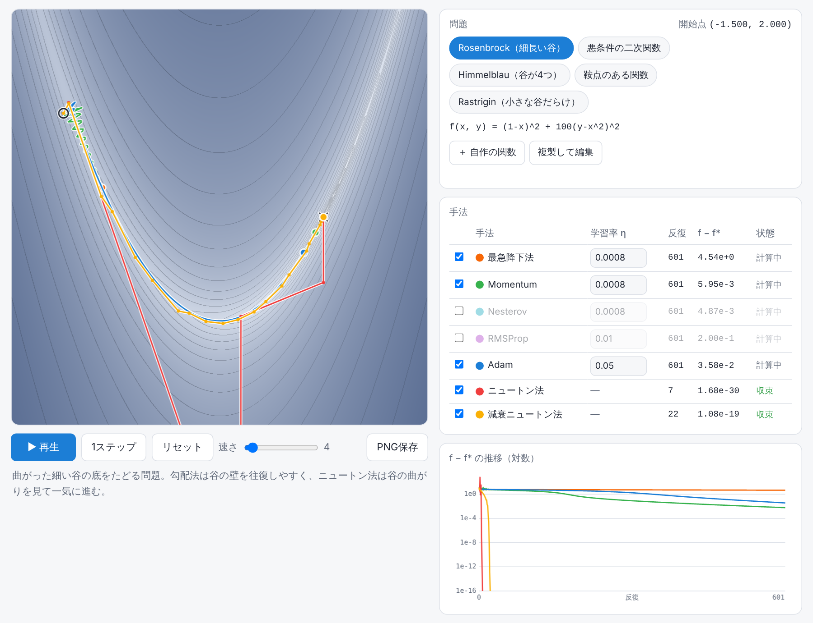

# Optimizer Playground

最急降下法・Momentum・Nesterov・RMSProp・Adam・ニュートン法・減衰ニュートン法を、同じ開始点から同時に走らせて、等高線の上で軌跡を比べられるブラウザツールです。用意した5つの問題に加えて、自分で書いた関数も試せます。

**▶ https://ibaran1um.github.io/Optimizer-Playground/**

## できること

- 5種類の目的関数（Rosenbrock・悪条件の二次関数・Himmelblau・鞍点のある関数・Rastrigin）を一覧から切り替えて試せます
- **自作の関数**を何個でも追加できます（`(x + 2y - 7)^2 + (2x + y - 5)^2` のように書くだけ）。追加した関数はブラウザに保存され、URLで共有もできます
- **全問題でまとめて比較**すると、問題×手法の表で「何回で収束したか／どこで止まったか／発散したか」が一覧できます
- 等高線をクリックすると、その点から全手法をやり直します
- 手法ごとに学習率を変えられます。発散したら表に「発散」と出て止まります
- 右側のグラフで、f − f*（最小値との差）を対数で比べられます
- 凡例つきの PNG で保存できます（スペースキーで再生／一時停止）

## 見どころ

| 関数 | 何が見えるか |
| --- | --- |
| Rosenbrock | 勾配法は細い谷の壁を往復し、ニュートン法は数回で谷底に着く |
| 悪条件の二次関数 | 曲がり方が方向で25倍違うと、勾配法は遅い方向がなかなか進まない |
| Himmelblau | 開始点と手法で、4つある谷のどこに落ちるかが変わる |
| 鞍点のある関数 | 素のニュートン法は鞍点に向かって止まり、減衰ニュートン法は本当の最小に向かう |
| Rastrigin | 局所的な情報だけで動く手法は、近くの小さな谷に捕まる |

## 自作の関数

「＋ 自作の関数」から、式・表示範囲・開始点を入れて保存します。既存の問題を「複製して編集」から始めることもできます。

- 変数は `x` と `y`。演算は `+ - * / ^`（`**` も可）で、`2x` や `3(x+1)` のような掛け算の省略もできます
- 関数：`sin cos tan asin acos atan sinh cosh tanh exp log(=ln) log10 sqrt abs sign`、定数：`pi e`
- 勾配は式から**記号微分**で正確に求めます（入力中に ∂f/∂x・∂f/∂y が表示されます）。式は構文木に直してから計算用の関数を組み立てるので、入力した文字列がそのまま実行されることはありません
- 最小値 f* がわからないときは空欄で構いません。表示範囲の中で探した値を使い、手法がもっと低い点を見つけたら自動で更新します
- 学習率の初期値は、開始点まわりの曲がり具合（ヘッセ行列の固有値）から決めます
- `log(x)` のように定義域がある関数では、計算できない範囲を斜線で示します。手法がその外に出たら「発散」として止まります
- 「共有URL」で、その関数を開くURLをコピーできます。開いた人のブラウザにも追加されます

## 手法の中身

| 手法 | 更新 |
| --- | --- |
| 最急降下法 | x ← x − η∇f |
| Momentum | v ← 0.9v − η∇f、x ← x + v |
| Nesterov | 先読み位置 x + 0.9v で勾配を取って Momentum と同じ更新 |
| RMSProp | s ← 0.9s + 0.1g²、x ← x − ηg/√s |
| Adam | β₁ = 0.9、β₂ = 0.999、バイアス補正あり |
| ニュートン法 | x ← x − H⁻¹∇f |
| 減衰ニュートン法 | x ← x − (H + λI)⁻¹∇f。H + λI が正定値になるよう λ に下限を設け、f が下がれば λ を小さく、下がらなければ大きくする（Levenberg–Marquardt 型） |

ヘッセ行列 H は勾配の中心差分で求めています。

## ファイル構成

| ファイル | 役割 |
| --- | --- |
| `index.html` | 画面 |
| `style.css` | 見た目（ライト／ダーク両対応） |
| `expr.js` | 自作関数の数式パーサと記号微分 |
| `optim.js` | 目的関数と各手法の計算。描画から独立していて、Node でも `require` できます |
| `app.js` | 描画と操作 |

ビルドは不要です。`index.html` をブラウザで開けば動きます。

### 組み込みの問題や手法を足すには

`optim.js` の `FUNCTIONS` に関数（式・値・勾配・表示範囲・最小点・初期学習率）を、`METHODS` と `METHOD_ORDER` に手法（`init` と `step`）を足すと、画面と一括比較の表にそのまま出ます。

## ライセンス

MIT License
